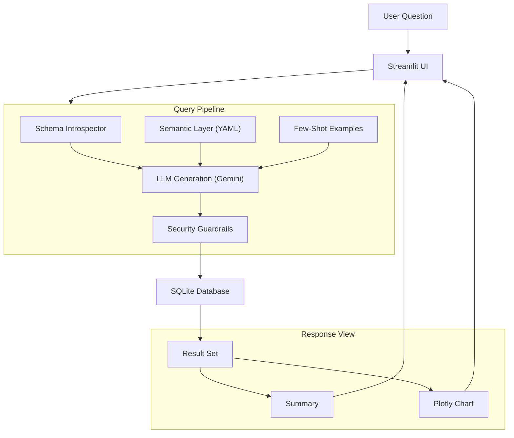

# DataTalk: Natural Language to SQL Assistant

[](https://www.python.org/)
[](https://vivek-295-datatalk-ai-app-mgzpon.streamlit.app)
[](https://www.sqlite.org/)
[](https://opensource.org/licenses/MIT)

> **Live Demo:** [https://vivek-295-datatalk-ai-app-mgzpon.streamlit.app](https://vivek-295-datatalk-ai-app-mgzpon.streamlit.app)  
> **Author:** Vivek Yadav ([@Vivek-295](https://github.com/Vivek-295))

---

## Overview

DataTalk is a web-based natural language interface for relational databases. It translates plain English questions into verified SQL queries, executes them against an SQLite database, and returns the data alongside an interactive chart and summary.

The goal is to let non-technical team members (marketing, sales, operations) explore company data directly without waiting on data analysts to write custom SQL for every ad-hoc question.



---

## Key Features

- **Natural Language to SQL:** Ask questions in plain English and receive executable SQLite queries.
- **Semantic Model Layer (`config/semantic_layer.yaml`):** Maps business terminology and definitions (such as net revenue, churn criteria, and average order value) so the model uses the right calculations and table joins.
- **Few-Shot Examples (`config/few_shot_examples.yaml`):** Injects verified reference queries into the prompt to ensure correct SQLite date handling and aggregations.
- **Read-Only Security Guardrails (`src/security.py`):** Restricts queries strictly to `SELECT` and `WITH` statements, blocks mutating keywords (`DROP`, `DELETE`, `UPDATE`, `ALTER`), and caps row limits to prevent memory exhaustion.
- **Automatic Visualizations (`src/visualizer.py`):** Automatically selects and renders the appropriate Plotly chart (line charts for trends, donut charts for distributions, bar charts for comparisons).
- **Built-in Demo Mode:** Includes an offline fallback with sample questions so the application works out of the box even without an API key.

---

## Technical Highlights

### Semantic Accuracy over Syntax
In database agents, the main difficulty is not generating valid SQL syntax, but generating the **correct business logic**. For instance:
- Filtering revenue by `status IN ('Completed', 'Shipped')` so cancelled or refunded orders are not counted as revenue.
- Choosing the right foreign key join paths when multiple relationships exist between tables.

DataTalk addresses this by combining automated schema introspection with a lightweight semantic YAML configuration that defines core business metrics and table relationships before prompting the model.

### Query Sandboxing
To ensure safety:
- Only read-only statements (`SELECT` / `WITH`) are permitted.
- Multi-statement execution via semicolons is blocked to prevent SQL injection.
- Unbounded queries are automatically capped with a `LIMIT 200` clause.

---

## Project Structure

```
DataTalk-AI/
├── .streamlit/
│   └── config.toml           # Streamlit theme configuration
├── config/
│   ├── semantic_layer.yaml   # Metric definitions, entity synonyms, and join hints
│   └── few_shot_examples.yaml# Verified reference SQL queries
├── data/
│   ├── seed_database.py      # Database generator with sample data
│   └── enterprise_data.db    # Seeded SQLite database (7 tables, 1,800+ records)
├── src/
│   ├── __init__.py
│   ├── agent.py              # LLM query orchestration and synthesis
│   ├── db_engine.py          # SQLite connection and schema introspection
│   ├── few_shot.py           # Few-shot example manager
│   ├── security.py           # SQL validator and query sanitizer
│   ├── semantic_layer.py     # Semantic configuration loader
│   └── visualizer.py         # Plotly chart generator
├── tests/
│   └── test_agent.py         # Test suite
├── app.py                    # Streamlit web interface
├── requirements.txt
├── .env.example
├── LICENSE
└── README.md
```

---

## Running Locally

```bash
git clone https://github.com/Vivek-295/DataTalk-AI.git
cd DataTalk-AI
pip install -r requirements.txt
streamlit run app.py
```

To run the test suite:
```bash
pytest tests -v
```

---

## Sample Questions

| Area | Sample Question |
| :--- | :--- |
| **Sales** | "What were our top 5 best-selling products by total revenue?" |
| **Trends** | "Show the monthly revenue trend for the year 2024." |
| **Segments** | "Which customer segments generate the highest average order value?" |
| **Customers** | "Identify top 5 customers with the highest lifetime spend." |
| **Marketing** | "Compare marketing campaign budget versus actual conversions by channel." |
| **Inventory** | "Which products have the lowest stock quantity and what is their current status?" |

---

## License

This project is licensed under the [MIT License](LICENSE).
