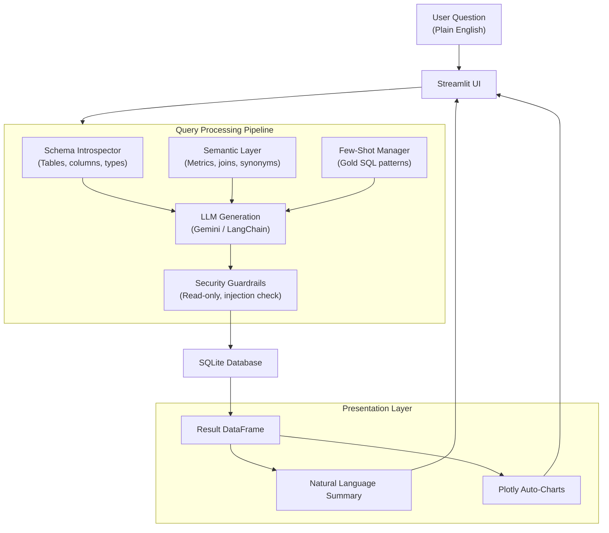

# DataTalk: Natural Language to SQL Assistant

[](https://www.python.org/)
[](https://vivek-295-datatalk-ai-app-mgzpon.streamlit.app)
[](https://www.sqlite.org/)
[](https://opensource.org/licenses/MIT)

> **Live Demo:** [https://vivek-295-datatalk-ai-app-mgzpon.streamlit.app](https://vivek-295-datatalk-ai-app-mgzpon.streamlit.app)  
> **Author:** Vivek Yadav ([@Vivek-295](https://github.com/Vivek-295))

---

## Overview

**DataTalk** is a conversational database assistant that translates plain English questions into verified SQL queries, executes them against a relational database, and presents the results alongside interactive visualizations.

It addresses the common reporting bottleneck where non-technical teams (product, marketing, operations) need ad-hoc data insights but depend on data analysts or engineering teams to write queries.



---

## Features

- **Natural Language Querying:** Ask questions in plain English (e.g., *"What were our top 5 products by revenue?"*).
- **Semantic Model Layer (`config/semantic_layer.yaml`):** Standardizes business metrics (Gross Revenue, AOV, Churn) and entity synonyms in a structured YAML configuration, preventing incorrect table joins or metric calculations.
- **Few-Shot Query Grounding (`config/few_shot_examples.yaml`):** Injects verified SQLite queries into the context to improve accuracy and ensure proper date formatting (`strftime`) and aggregations.
- **Read-Only Security Guardrails (`src/security.py`):** Restricts execution strictly to `SELECT` and `WITH` statements, blocking mutating keywords (`DROP`, `DELETE`, `UPDATE`, `INSERT`, `ALTER`, etc.) and enforcing automatic row limits.
- **Automated Visualizations (`src/visualizer.py`):** Automatically selects and renders the appropriate Plotly chart (line charts for time series, donut charts for distributions, bar charts for comparisons).
- **Interactive UI (`app.py`):** Built with Streamlit, featuring query execution telemetry, CSV download, collapsible SQL views, and a database schema explorer.
- **Offline Demo Mode:** Includes a deterministic fallback engine so the application remains fully functional and testable even without an active API key.

---

## Architecture & Engineering Decisions

### Addressing "Semantic Failures"
When building natural language interfaces for databases, the primary challenge is rarely syntax—it is **semantic accuracy**. A query may be syntactically valid yet return incorrect business figures (such as counting cancelled orders as revenue, or joining tables incorrectly).

DataTalk addresses this by decoupling the data context into three layers:
1. **Schema Introspection:** Automatically inspects tables, column types, foreign keys, and sample records without exposing raw private rows.
2. **Semantic Rules:** Defines business logic (e.g., filtering revenue queries by `status IN ('Completed', 'Shipped')`).
3. **Few-Shot Examples:** Provides verified reference patterns for SQLite dialect handling.

### Query Sandboxing
To protect against destructive queries and SQL injection:
- Queries must begin with `SELECT` or `WITH`.
- Multiple statements chained via semicolons are blocked.
- Potentially destructive commands are rejected via regex validation.
- Unbounded queries are capped to a maximum of 200 rows to prevent high memory usage.

---

## Project Structure

```
DataTalk-AI/
├── .streamlit/
│   └── config.toml           # Streamlit theme and server configuration
├── config/
│   ├── semantic_layer.yaml   # Business metric formulas, synonyms, and join paths
│   └── few_shot_examples.yaml# Verified SQL reference queries
├── data/
│   ├── seed_database.py      # Seed script for generating realistic test data
│   └── enterprise_data.db    # Seeded SQLite database (7 tables, 1,800+ records)
├── src/
│   ├── __init__.py
│   ├── agent.py              # Query orchestration, LLM calling, and response synthesis
│   ├── db_engine.py          # SQLite connection and schema introspection
│   ├── few_shot.py           # Few-shot example loader
│   ├── security.py           # SQL validator and query sanitizer
│   ├── semantic_layer.py     # Semantic configuration parser
│   └── visualizer.py         # Plotly visualization generator
├── tests/
│   └── test_agent.py         # Unit and integration test suite
├── app.py                    # Streamlit web application
├── requirements.txt          # Python dependencies
├── .env.example              # Environment variables template
├── .gitignore
├── LICENSE                   # MIT License
└── README.md
```

---

## Installation & Setup

### 1. Clone the Repository
```bash
git clone https://github.com/Vivek-295/DataTalk-AI.git
cd DataTalk-AI
```

### 2. Create a Virtual Environment
```bash
python -m venv .venv

# Windows
.venv\Scripts\activate

# macOS / Linux
source .venv/bin/activate
```

### 3. Install Dependencies
```bash
pip install -r requirements.txt
```

### 4. Configure API Key (Optional)
The app includes an offline demo mode that works without an API key. To enable live generation with Google Gemini:

1. Obtain a Gemini API key from [Google AI Studio](https://aistudio.google.com/app/apikey).
2. Create a `.env` file from the example:
   ```bash
   cp .env.example .env
   ```
3. Set your key:
   ```env
   GEMINI_API_KEY=your_api_key_here
   ```
*(You can also input your key directly into the sidebar in the web interface).*

### 5. Run the Application
```bash
streamlit run app.py
```
Open `http://localhost:8501` in your browser.

### 6. Run Tests
```bash
pytest tests -v
```

---

## Example Queries

| Category | Sample Question |
| :--- | :--- |
| **Sales** | "What were our top 5 best-selling products by total revenue?" |
| **Trends** | "Show the monthly revenue trend for the year 2024." |
| **Customer Segments** | "Which customer segments generate the highest average order value?" |
| **Customer Retention** | "Identify the top 5 customers with the highest lifetime spend." |
| **Marketing** | "Compare marketing campaign budget versus actual conversions by channel." |
| **Inventory** | "Which products have the lowest stock quantity and what is their current status?" |

---

## License

This project is licensed under the [MIT License](LICENSE).
