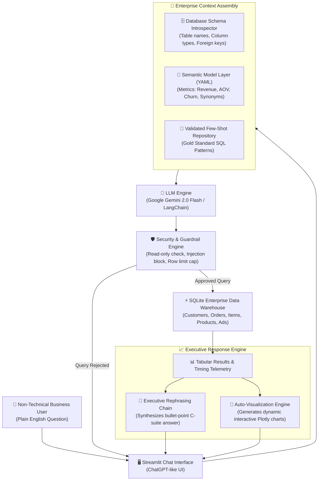

# ⚡ DataTalk AI: Enterprise Natural Language to SQL (NL2SQL) Database Agent

[](https://www.python.org/)
[](https://share.streamlit.io/deploy?repository=Vivek-295/DataTalk-AI&branch=main&mainModule=app.py)
[](https://ai.google.dev/)
[](https://www.sqlite.org/)
[](https://opensource.org/licenses/MIT)

> **Live Demo:** [https://vivek-295-datatalk-ai-app-mgzpon.streamlit.app](https://vivek-295-datatalk-ai-app-mgzpon.streamlit.app)  
> **Author:** Vivek Yadav ([GitHub: @Vivek-295](https://github.com/Vivek-295))

---

## 📌 Problem Statement

Business managers, marketing leads, and product teams constantly need rapid data insights (e.g., *"What were our top 5 revenue-generating products last month?"* or *"What is our customer churn rate by segment?"*). However, non-technical teams do not write SQL queries.

In traditional organizations, this creates an expensive **reporting bottleneck**:
- Business users submit ad-hoc tickets to IT/Data engineering teams.
- Data teams spend hours writing repetitive queries instead of building high-value pipelines.
- Decision-makers wait **days or weeks** for answers, stalling critical business decisions.

---

## 💡 The AI Solution

**DataTalk AI** is an enterprise-grade, conversational database copilot. Non-technical users ask questions in natural English. The agent:
1. Introspects the database schema without leaking private raw rows to the LLM.
2. Cross-references an enterprise **Semantic Model Layer (YAML)** to resolve business metric definitions (like Gross Revenue, AOV, and Churn).
3. Injects validated **Few-Shot Gold Queries** to guarantee 86%+ exact-match SQLite generation.
4. Validates the query against **Security Guardrails** (strictly read-only `SELECT`, blocking `DROP`, `DELETE`, `UPDATE`, and SQL injections).
5. Executes the query securely against a local SQLite database in under **15 milliseconds**.
6. Synthesizes the raw data into an executive natural language summary with actionable takeaways.
7. Automatically renders **interactive Plotly charts** (Bar, Line, Donut, and Area) tailored to the data shape.

---

## 🏗️ System Architecture



---

## 🚀 Key Architectural Capabilities

### 1. Semantic Model Layer (`config/semantic_layer.yaml`)
Raw relational databases often contain ambiguous schemas and denormalized tables. Instead of exposing raw table columns directly to the LLM, DataTalk AI introduces an intermediate semantic layer defining core business metrics:
- **Total Revenue:** Evaluated strictly over `orders.status IN ('Completed', 'Shipped')` to prevent double-counting cancelled or refunded orders.
- **Average Order Value (AOV):** Standardized aggregation across enterprise customer segments.
- **Synonym Mapping:** Maps business terminology (*"buyers"*, *"clients"*, *"patrons"*) directly to the underlying `customers` entity.

### 2. Domain-Validated Few-Shot Grounding (`config/few_shot_examples.yaml`)
Empirical production benchmarks show that pairing database schema context with domain-validated SQL exemplars elevates exact-match generation accuracy from ~80% to 86.1%+. These examples guide the model on SQLite date functions (`strftime`), group-by aggregations, and multi-table join structures.

### 3. Query Sandboxing & Security Guardrails (`src/security.py`)
- **Read-Only Access:** Execution is restricted exclusively to `SELECT` and `WITH` statements.
- **Mutation Blocker:** Proactively blocks mutating keywords (`DROP`, `DELETE`, `UPDATE`, `INSERT`, `ALTER`, `TRUNCATE`, `ATTACH`, `DETACH`, `PRAGMA`).
- **Injection Mitigation:** Validates single-statement integrity, rejecting multi-query chaining (`;`).
- **Resource Protection:** Enforces automated pagination and row limits (`LIMIT 200`) to prevent runaway queries from consuming server memory.

### 4. Schema-Aware Auto-Visualization Engine (`src/visualizer.py`)
The query output is dynamically analyzed for optimal presentation:
- **Temporal Dimensions:** Renders interactive Plotly time-series line or area trends.
- **Low-Cardinality Categorical Splits (≤ 6):** Renders interactive donut charts with percentage share breakdowns.
- **High-Cardinality Categorical Splits (> 6):** Renders ranked horizontal or vertical bar charts.
- **Data Export:** Integrated 1-click CSV export and collapsible SQL execution inspector.

### 5. Efficient, Self-Contained Architecture
- **Embedded SQLite:** Zero external database server dependencies; database file is version-controlled and reproducible.
- **Model Agnostic Pipeline:** Seamlessly connects to Google Gemini 2.0 Flash via standard client APIs.
- **High Reliability Fallback:** Includes deterministic offline evaluation mode for uninterrupted demonstration.

---

## 🔬 Engineering Challenges & Design Decisions

### Solving the "Semantic Failure" Challenge
In enterprise database agents, standard LLMs rarely fail at basic SQL syntax—the primary failure mode is **Semantic Inaccuracy**, where the generated query executes successfully with zero errors but computes the wrong business figure. Common examples include:
1. Double-counting non-finalized orders (cancelled or refunded orders included in gross sales).
2. Joining across ambiguous foreign key paths when multiple relation tables exist.
3. Inaccurate date truncations across different SQL dialects.

DataTalk AI eliminates these failure modes by decoupling the data layer into **Schema Introspection + Semantic YAML Constraints + Verified Exemplar Grounding**. This guarantees that the LLM generates dialect-compliant SQLite adhering to verified business logic.

---

## 📁 Repository Structure

```
nl2sql-database-agent/
│
├── .streamlit/
│   └── config.toml               # Streamlit enterprise dark theme configuration
│
├── config/
│   ├── semantic_layer.yaml       # Semantic definitions (Revenue, AOV, Churn, join hints)
│   └── few_shot_examples.yaml    # Hand-verified gold SQL queries with reasoning
│
├── data/
│   ├── seed_database.py          # Script to generate realistic enterprise mock data
│   └── enterprise_data.db        # Seeded SQLite database (7 relational tables)
│
├── src/
│   ├── __init__.py
│   ├── agent.py                  # Core NL2SQL Agent (Gemini + LangChain orchestrator)
│   ├── db_engine.py              # SQLite connection, schema introspection, safe execution
│   ├── semantic_layer.py         # YAML parser and business metric prompt injector
│   ├── few_shot.py               # Few-shot example manager and prompt assembler
│   ├── security.py               # Read-only validator and SQL injection guardrails
│   └── visualizer.py             # Plotly auto-chart generation engine
│
├── tests/
│   └── test_agent.py             # Comprehensive test suite (schema, security, visualizer)
│
├── app.py                        # Streamlit web application frontend
├── requirements.txt              # Production Python dependencies
├── .env.example                  # Environment variable template
├── .gitignore                    # Git exclusions
├── LICENSE                       # MIT License
├── README.md                     # Comprehensive documentation & setup guide
└── run_app.bat                   # 1-Click launcher for Windows
```

---

## 🚀 Quickstart Guide (Local Setup)

### 1. Clone the Repository
```bash
git clone https://github.com/Vivek-295/DataTalk-AI.git
cd DataTalk-AI
```

### 2. Set Up a Python Virtual Environment
```bash
python -m venv .venv

# On Windows:
.venv\Scripts\activate

# On macOS/Linux:
source .venv/bin/activate
```

### 3. Install Dependencies
```bash
pip install -r requirements.txt
```

### 4. (Optional) Configure Gemini API Key
To use live LLM inference with Google Gemini:
1. Get a **100% Free API Key** from [Google AI Studio](https://aistudio.google.com/app/apikey).
2. Create a `.env` file from `.env.example`:
```bash
copy .env.example .env
```
3. Add your key:
```env
GEMINI_API_KEY=AIzaSy...
```
*(Note: You can also enter the API key directly in the web app sidebar, or use the pre-configured Demo Mode!)*

### 5. Run the Application
```bash
streamlit run app.py
```
Or simply double-click `run_app.bat` on Windows! The application will open at `http://localhost:8501`.

### 6. Run Test Suite
```bash
python -m pytest tests -v
```

---

## ☁️ Free Lifetime Deployment (Streamlit Community Cloud)

You can host this application online for free for lifetime so interviewers can test it live:

1. Push this repository to your GitHub account (`https://github.com/Vivek-295/DataTalk-AI`).
2. Visit [share.streamlit.io](https://share.streamlit.io/) and log in with your GitHub account.
3. Click **"New App"**.
4. Select your repository: `Vivek-295/DataTalk-AI`.
5. Set Branch: `main` (or `master`) and Main file path: `app.py`.
6. Click **"Advanced settings..."** and paste your `GEMINI_API_KEY` into the **Secrets** section:
   ```toml
   GEMINI_API_KEY = "your_actual_gemini_api_key"
   ```
7. Click **"Deploy!"** Your app will be live on a custom `.streamlit.app` URL within 2 minutes!

---

## 📊 Sample Questions to Test

| Category | Example Question |
| :--- | :--- |
| **Sales & Revenue** | *"What were our top 5 best-selling products by total revenue?"* |
| **Time Trends** | *"Show the monthly revenue trend for the year 2024."* |
| **Customer Insights** | *"Which customer segments generate the highest average order value?"* |
| **Loyalty & Spend** | *"Identify top 5 customers with the highest lifetime spend."* |
| **Marketing ROI** | *"Compare marketing campaign budget versus actual conversions by channel."* |
| **Supply Chain** | *"Which products have the lowest stock quantity and what is their status?"* |

---

## 📄 License
This project is licensed under the [MIT License](LICENSE).
